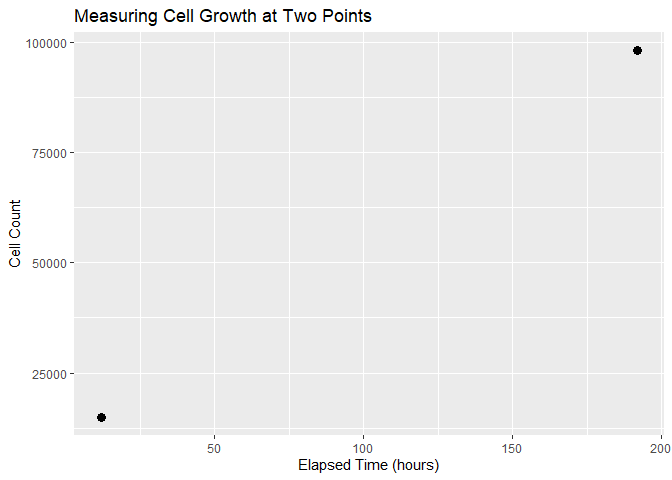
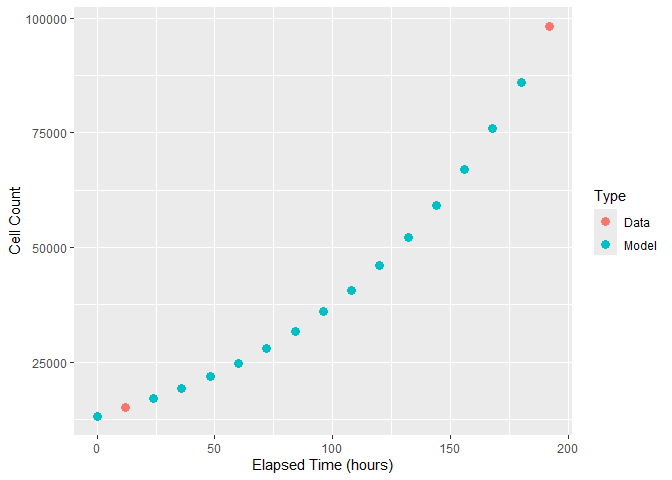
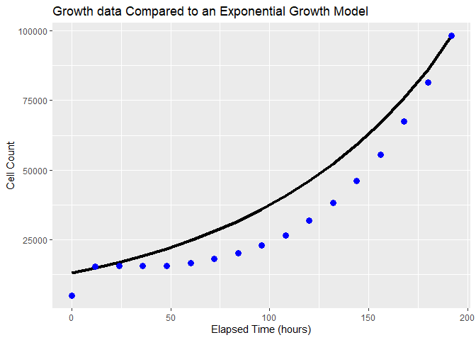
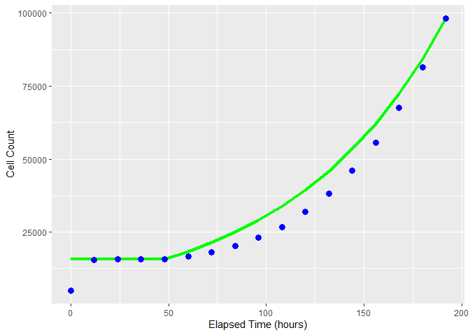
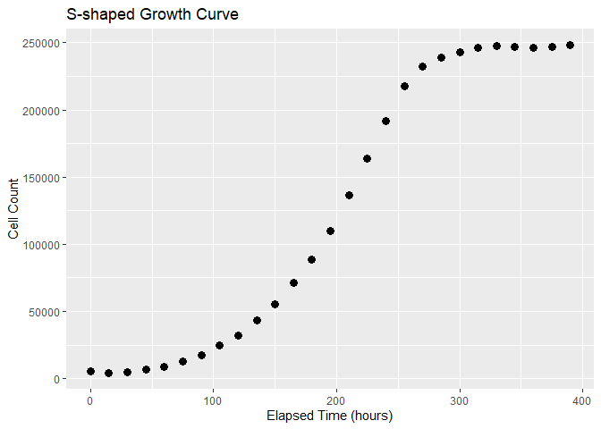
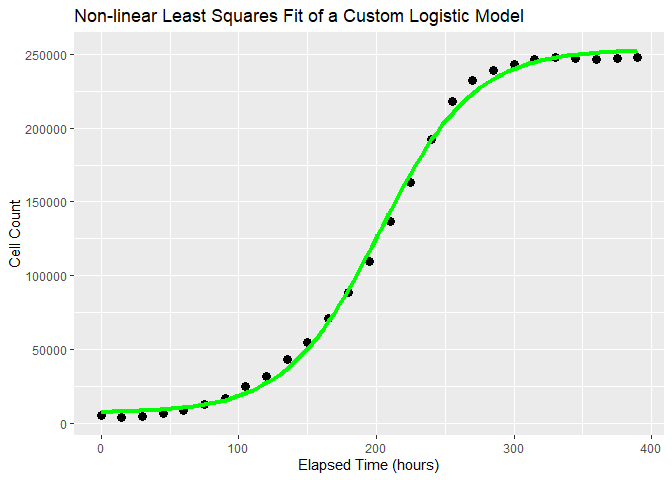
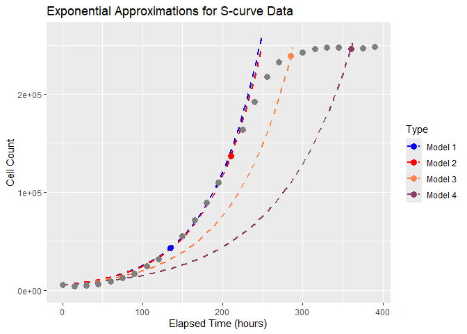
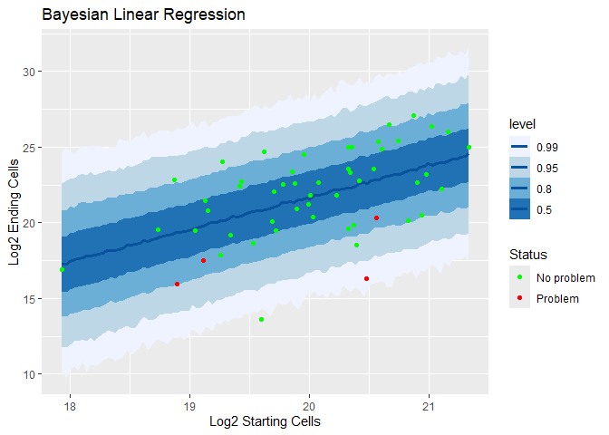

# Exponential Growth Models for Cell Therapy

Benjamin I. Espen 2026-07-28

# Cell expansion processes in cell and gene therapy

This is an exploration of how I gain insight from data. The data I will be using is derived from real data, but has been anonymized and manipulated to isolate it from its source. I like using real(ish) data for this because real data has more surprises in it than simulated data does. Part of using data is deciding how to deal with all the complications and messiness that come with data collection. Real data is not perfect. It also does not need to be perfect before we can make use of it.

For this I will be using cell count data from cellular expansion processes. Cell expansion processes are common to most cell and gene therapy products, as you almost always start with fewer cells than you would like to use. The biological heart of a cellular expansion process is cellular division: one cell divides into two cells.

## Exponential growth model

This then suggests a model we might use: exponential growth. This model multiplies a doublings per unit time parameter represented by $T_D$ by an elapsed time to calculate the number of doublings. A standard exponential growth model uses a base of *e*, but for cell growth the natural base is *2*. The result from raising *2* to the number of doublings is then multiplied by your starting cell count $q_1$ to produce a final cell count $q_2$.

$q_2 = q_1 * 2^{T_D * (t_2 - t_1)}$

## Fitting our exponential growth model

If we have a couple of cell counts with associated times, we can calculate $T_D$. Let’s look at an example that has been taken from a real data set, suitably anonymized.

``` r
# Make a data frame containing two cell counts at two elapsed times
df_exponential_growth <- as_tibble(data.frame(
  cell_number = c(15000 , 98000),
  elapsed_time = c(12 , 192)
))

# Show the data frame
df_exponential_growth
```

```         
## # A tibble: 2 × 2
##   cell_number elapsed_time
##         <dbl>        <dbl>
## 1       15000           12
## 2       98000          192
```

``` r
# Plot data points with ggplot
df_exponential_growth |> 
  ggplot(aes(x = elapsed_time, y = cell_number)) +
  geom_point(size = 3) +
    labs(
      x = "Elapsed Time (hours)", 
      y = "Cell Count", 
      title = "Measuring Cell Growth at Two Points"
      )
```

<!-- -->

We can interpolate intermediate cell counts between the two measurements using our exponential growth model. First we need to calculate $T_D$ from our two data points:

$q_2 = q_1 * 2^{T_D * (t_2 - t_1)}$

$q_2 / q_1 = 2^{T_D * (t_2 - t_1)}$

$log_2(q_2/q_1) = T_D *(t_2 - t_1))$

$\frac{log_2(q_2/q_1)}{t_2 - t_1} = T_D$

$\frac{log_2(98000/15000)}{192-12} = 0.015$

Since our time was in hours, $T_D$ is then in units of doublings per hour. Using the formula, I can then calculate a predicted cell count. I have done so for several intermediate times and placed that information in a file. Let’s open up that file and plot the results.

``` r
# Read in interpolated data points from a comma-delimited file
Interpolated_exponential <- read_csv("Interpolated_exponential.csv", show_col_types = FALSE)

# Show the data
Interpolated_exponential
```

```         
## # A tibble: 17 × 3
##     Time Cell_count Type 
##    <dbl>      <dbl> <chr>
##  1     0     13241. Model
##  2    12     15000  Data 
##  3    24     16993. Model
##  4    36     19251. Model
##  5    48     21810. Model
##  6    60     24708. Model
##  7    72     27991. Model
##  8    84     31711. Model
##  9    96     35924. Model
## 10   108     40698. Model
## 11   120     46106. Model
## 12   132     52233. Model
## 13   144     59174. Model
## 14   156     67037. Model
## 15   168     75945. Model
## 16   180     86037. Model
## 17   192     98099. Data
```

This file also has a categorical column called ‘Type’ that I am using to show whether a given value is data from a measurement or a calculation from a model. With that category, we can color code the resulting plot.

``` r
# Plot data points with ggplot, color coding by whether the point is measured or calculated
Interpolated_exponential |> 
  ggplot(aes(x = Time, y = Cell_count, color = Type)) +
  geom_point(size = 3) +
  labs(
    x = "Elapsed Time (hours)",
    y = "Cell Count",
    title = "Cell Growth Data at Two Points with an Exponential Model"
  )
```

<!-- -->

You might observe that I also extrapolated one point, the cell count at *t* = 0. The reason for that will become clear shortly.

One of the nice properties of an exponential growth model is that it has a constant doublings per unit time. If our cellular expansion process truly is exhibiting exponential growth, we should get the same $T_D$ from any two points. I have cell count data at all the same time points as I used for interpolation, so we can see how well the model performed.

``` r
# Load the full cell growth data set
Cell_growth <- read_csv("Cell_growth.csv", show_col_types = FALSE)

# Display the full data set
Cell_growth
```

```         
## # A tibble: 17 × 3
##    Cell_count  Time Measurement_error
##         <dbl> <dbl>             <dbl>
##  1      5078.     0              141.
##  2     15363.    12              912.
##  3     15668.    24              905.
##  4     15702.    36              888.
##  5     15759.    48              863.
##  6     16593.    60              904.
##  7     18129.    72              977.
##  8     20157.    84             1050.
##  9     23005.    96             1166.
## 10     26676.   108             1339.
## 11     31939.   120             1576.
## 12     38152.   132             1866.
## 13     46108.   144             2180.
## 14     55604.   156             2641.
## 15     67513.   168             3134.
## 16     81529.   180             3727.
## 17     98099.   192             4475.
```

``` r
# Overlay real data on the model. The model is shown as a line, while the data
# are plotted as discrete dots. 
ggplot(Interpolated_exponential, aes(Time, Cell_count)) + 
  geom_line(linewidth = 1.5) + 
  geom_point(data = Cell_growth, colour = "blue", size = 3) +
  labs(
    x = "Elapsed Time (hours)",
    y = "Cell Count",
    title = "Growth data Compared to an Exponential Growth Model"
    )
```

<!-- -->

Now you can see one of the complications of real data that we need to address. The *t* = 0 data point is unexpectedly low. In the real data set this was derived from, this pattern was seen repeatedly. I interpreted this an error in the cell count method because I didn’t think it was biologically plausible that the cell count would truly jump up like that and then flatten out. In the absence of a good measurement, I ignored the *t* = 0 data point, starting my modeling at *t* = 12, and I then extrapolated a more plausible *t* = 0 from the model.

However, it is also clear that the exponential growth model is not quite right for this data. From 12 hours to 48 hours, the cell count changes very little. After that point, something that looks very similar to exponential growth occurs. If we think biologically again for a moment, it isn’t surprising that the cells are not dividing as normal. In circumstances like this, cells have often just endured some insult, such as enzymatic detachment or centrifugation. It is not uncommon to see a delay while the cells recover.

This suggests an improvement. We could shift the beginning of our exponential model to 48 hours, and substitute the cell count at 48 hours for all preceding time points. Our doublings per hour value needs to change in order to make this happen. Let’s calculate a new $T_D$ and then model new data points starting at 48 hours.

$\frac{log_2(98000/15759)}{192-48} = 0.018$

``` r
# Load a shifted exponential growth model that has no growth in the first 48 hours
Shifted_exp_model <- read_csv("Shifted_exp_model.csv", show_col_types = FALSE)

# Show the model values
Shifted_exp_model
```

```         
## # A tibble: 17 × 3
##     Time Cell_count Type 
##    <dbl>      <dbl> <chr>
##  1     0     15759. Model
##  2    12     15759. Model
##  3    24     15759. Model
##  4    36     15759. Model
##  5    48     15759. Data 
##  6    60     18395. Model
##  7    72     21420. Model
##  8    84     24941. Model
##  9    96     29042. Model
## 10   108     33817. Model
## 11   120     39377. Model
## 12   132     45851. Model
## 13   144     53389. Model
## 14   156     62167. Model
## 15   168     72388. Model
## 16   180     84289. Model
## 17   192     98099. Data
```

``` r
# Plot the shifted model in green with the measured data in blue
ggplot(Shifted_exp_model, aes(Time, Cell_count)) + 
  geom_line(color = "green", linewidth = 1.5) + 
  geom_point(data = Cell_growth, colour = "blue", size = 3) +
  labs(
    x = "Elapsed Time (hours)",
    y = "Cell Count",
    title = "Shifted Exponential Growth Model"
    )
```

<!-- -->

That is much closer, although you can still see that the cell counts are systematically lower than the model predictions up until the last data point. The reason for this is that cell expansion processes only approximately follow exponential growth over some time domains. The problem is that the exponential growth model knows no limits. However, at some point, the cells will run out of room, run out of food, run out of oxygen, or make too much waste, and growth will slow down or stop.

## Logistic growth model

This kind of growth process that slows and then stops can be modeled as logistic growth. There are a lot of ways to parametrize logistic functions, here I’m going to follow along with what I used for exponential growth. *L* is the lower asymptote, or our starting cell count, *U* is the upper asymptote, $T_D$ is again our rate parameter, and *M* is the inflection point of the logistic curve in hours.

$q_2 = U + \frac{L-U}{1+2^{T_D*(t-M)}}$

Here is another anonymized data set that goes out longer so we can see the shape of the whole growth curve.

``` r
# Load a cell growth data set that shows a s-shaped curve
Logistic_cell_growth <- read_csv("Logistic_cell_growth.csv", show_col_types = FALSE)

# Show the data
Logistic_cell_growth
```

```         
## # A tibble: 27 × 4
##     Time Cell_count Measurement_error Type   
##    <dbl>      <dbl>             <dbl> <chr>  
##  1     0      5171.              204. Data   
##  2    15      4306.              173. Data   
##  3    30      4672.              194. Data   
##  4    45      6455.              260. Data   
##  5    60      8978.              373. Data   
##  6    75     12748.              473. Data   
##  7    90     17093.              606. Data   
##  8   105     24874.              986. Data   
##  9   120     31865.             1121. Data   
## 10   135     43379.             1584. Model 1
## # ℹ 17 more rows
```

``` r
# Plot the data 
Logistic_cell_growth %>% 
  ggplot(aes(x = Time, y = Cell_count)) +
  geom_point(size = 3) +
  labs(
    x = "Elapsed Time (hours)",
    y = "Cell Count",
    title = "S-shaped Growth Curve"
  )
```

<!-- -->

Let’s fit a logistic growth model to this data. Instead of solving for the parameters analytically, its easier to fit the model numerically. I will use a custom function for the growth model to match what I’ve defined above and then solve for the model parameters using the non-linear least squares function *nls()*.

As I noted above, there are multiple different ways to parametrize a logistic function. I like this way because the parameters all have simple and easy to understand interpretations in biological terms. This is important because in order to fit the model, I need to give the numerical solver my best guesses about the parameter values so it doesn’t start too far away. That job is easier when you can look at a chart and read those parameters from it.

In this case, we will need a lower asymptote or starting cell count *L*, an upper asymptote or plateau cell count *U*, the time when the model reaches 50% of its upper asymptote *M*, and a growth rate $T_D$. Three out of four can be taken easily from the plot, but the growth rate parameter may be a little harder. The rate parameter in the logistic growth model isn’t the same as the one from the exponential growth model, but it will be close enough if we calculate a starting guess from that model using the *t=0* data point and something in the middle.

$\frac{log_2(109655/5171)}{195-0} = 0.023$

``` r
# Define the logistic function: q_2 = U + ((L - U)/(1 + 2^(T_D * (t - M))))
logistic_func <- function(t, L, U, T_D, M) {
  U + ((L - U)/(1 + 2^(T_D * (t - M))))
}

# Fit using nls with manual start values
manual_fit <- nls(Cell_count ~ logistic_func(Time, L, U, T_D, M), 
                  data = Logistic_cell_growth, 
                  start = list(L = 5000, U = 250000, T_D = 0.023, M = 195))   

# View parameter estimates
summary(manual_fit)
```

```         
## 
## Formula: Cell_count ~ logistic_func(Time, L, U, T_D, M)
## 
## Parameters:
##      Estimate Std. Error t value Pr(>|t|)    
## L   7.057e+03  2.107e+03   3.349  0.00278 ** 
## U   2.533e+05  2.294e+03 110.406  < 2e-16 ***
## T_D 4.236e-02  1.814e-03  23.358  < 2e-16 ***
## M   2.026e+02  1.575e+00 128.625  < 2e-16 ***
## ---
## Signif. codes:  0 '***' 0.001 '**' 0.01 '*' 0.05 '.' 0.1 ' ' 1
## 
## Residual standard error: 4948 on 23 degrees of freedom
## 
## Number of iterations to convergence: 7 
## Achieved convergence tolerance: 5.106e-06
```

``` r
# Create a grid of x values for the line
logistic_fit_df <- as_tibble(data.frame(
  Time = seq(min(Logistic_cell_growth$Time), max(Logistic_cell_growth$Time), length.out = 100)
  ))

# Predict y values based on the fitted model
logistic_fit_df$y_pred <- predict(manual_fit, newdata = logistic_fit_df)   

# Plot the non-linear fit in green and the data in black
ggplot(Logistic_cell_growth, aes(Time, Cell_count)) + 
  geom_point(size = 3) + 
  geom_line(data = logistic_fit_df, aes(Time, y_pred), linewidth = 1.5, color = "green") +
  labs(
    x = "Elapsed Time (hours)",
    y = "Cell Count",
    title = "Non-linear Least Squares Fit of a Custom Logistic Model"
  )
```

<!-- -->

That’s not a bad model. However, you can see that it was considerably more complicated to fit, because we needed to use a numerical method and it also required substantially more data. It wouldn’t be possible at all to fit this model with only two data points like we did for the exponential model. This matters because we don’t always have more data.

For a simple experimental setup, we might only have the number of cells we put in, and the number of cells we get out. That will push us to using an exponential model, even if we think the underlying process is more like logistic growth. That might be acceptable, depending on where we are in the growth curve.

Let’s use the logistic growth curve data to see what that looks like. In the file for the logistic growth curve data, I again used a column called Type to identify specific points. This time, all the data points are measured, but we will use the points labeled Model1 through Model4 to calculate $T_D$ for four separate exponential growth models, and then plot those models against the data.

$\frac{log_2(43379/5171)}{135-0} = 0.023$

$\frac{log_2(136467/5171)}{210-0} = 0.022$

$\frac{log_2(238981/5171)}{285-0} = 0.019$

$\frac{log_2(246279/5171)}{360-0} = 0.015$

``` r
# Create new columns for each model
logistic_fit_df <- logistic_fit_df |>
  mutate(
    model1 = 5171 * 2^(0.022729*Time),
    model2 = 5171 * 2^(0.022486*Time),
    model3 = 5171 * 2^(0.019404*Time),
    model4 = 5171 * 2^(0.015483*Time)
    )

# Plot the new models against the growth data
ggplot(logistic_fit_df) + 
  geom_line(data = logistic_fit_df, aes(Time, model1, color ="Model 1"), linetype = "dashed", linewidth = 1) +
  geom_line(data = logistic_fit_df, aes(Time, model2, color ="Model 2"), linetype = "dashed", linewidth = 1) +
  geom_line(data = logistic_fit_df, aes(Time, model3, color ="Model 3"), linetype = "dashed", linewidth = 1) +
  geom_line(data = logistic_fit_df, aes(Time, model4, color ="Model 4"), linetype = "dashed", linewidth = 1) +
  geom_point(data = Logistic_cell_growth, aes(Time, Cell_count, color=Type), size = 3) +
  scale_color_manual(
    values = c(
      "Model 1" = "blue",
      "Model 2" = "red",
      "Model 3" = "sienna1",
      "Model 4" = "hotpink4"
      )
    ) +
  labs(
    x = "Elapsed Time (hours)",
    y = "Cell Count",
    title = "Exponential Approximations for S-curve Data"
  ) +
  scale_y_continuous(limits = c(0, 260000))
```

```         
## Warning: Removed 36 rows containing missing values or values outside the scale range
## (`geom_line()`).
## Removed 36 rows containing missing values or values outside the scale range
## (`geom_line()`).

## Warning: Removed 26 rows containing missing values or values outside the scale range
## (`geom_line()`).

## Warning: Removed 7 rows containing missing values or values outside the scale range
## (`geom_line()`).
```

<!-- -->

The first two exponential models (fit to data points at 135 and 210 hours respectively) are not too far off from the cellular growth process throughout its middle or log-growth phase. The utility of this is increased because it is often the case that a cellular expansion process will not be run until it reaches the plateau phase of logistic growth, because that means the cells are experiencing conditions that make them slow down or even stop cellular division. This is undesirable, and some manipulation will occur to remove the growth constraint. This could be passaging the cells and placing them in a bigger vessel, it could be a cellular growth medium exchange, or something else entirely, but the effect will be very much like moving the cells back down the S-curve to the part that looks more like exponential growth.

## Fitting Multiple Curves

Now, I’d like to see what happens if we take this model and apply it to a bunch of different sets of cell numbers and times. Instead of looking at one curve, we are going to look at a family of curves. We can do this directly, plotting each exponential curve on the same chart, but it may be more informative in this case to re-organize the problem.

Let’s return to our exponential model:

$q_2 = q_1 * 2^{T_D * (t_2 - t_1)}$

Earlier, I solved for $T_D$ by taking the logarithm base 2. Now, I’m going to do that again, because it will linearize the model, enabling us to visualize the different sets of data in an intuitive way.

$log_2(q_2) = log_2(q_1) + T_D * (t_2 - t_1)$

In this case, I have another anonymized data set, and this time all the durations are the same, so the time dependency drops out and we are left with a linear model where the slope represents a number of doublings.

``` r
# Load a bunch of log 2 cell counts that all have the same duration

Troubleshooting_exp_growth <- read_csv("Troubleshooting_exp_growth.csv", show_col_types = FALSE)

# Show the log 2 data
Troubleshooting_exp_growth
```

```         
## # A tibble: 53 × 3
##    Log2_ending_cells Log2_starting_cells Status    
##                <dbl>               <dbl> <chr>     
##  1              23.5                20.3 No problem
##  2              21.8                20.2 No problem
##  3              19.5                19.0 No problem
##  4              24.0                19.3 No problem
##  5              23.2                21.0 No problem
##  6              13.6                19.6 No problem
##  7              22.6                19.9 No problem
##  8              25.0                21.3 No problem
##  9              16.3                20.5 Problem   
## 10              20.3                20.6 Problem   
## # ℹ 43 more rows
```

Let’s use the `brm` package to fit a Bayesian linear regression to this data. In order to do that, we need to define a model and its priors. Much like with the *nls()* function, we will be using our knowledge of the process in question to determine the needed values, but in this case, instead of providing a starting value for a Gauss-Newton algorithm, we are going to be using a probability distribution to reflect what we already know, and also to constrain the solution space to plausible answers, a form of regularization.

For this, we will need an intercept prior, which is going to represent the number of cells seeded, a slope or *b* prior, which is the expected number of doublings, and a sigma parameter for the variability of the expansion process.

For this anonymized data, the intercept prior is centered on $2^{20}$ or close to 1 million cells. Since this is typically something under our control in cell expansion processes, this should be straightforward to define. `brms` automatically centers this prior, which is convenient for us in that we don’t need to try to estimate where this distribution would be at zero on the $log_2$ starting cells scale (the mathematical definition).

The slope or doublings prior should also be well-defined, as in most cases the duration and typical doubling time of the cells in question should be known before we get started. From the duration and the typical doubling time we can calculate a resultant number of doublings. We could constrain the slope to be positive, as we should have sufficient control to ensure that the cells will almost always grow, but in this case I’ll use a more generic prior that is symmetrical about zero and also quite broad. In practice I think it would be valuable to constrain it a bit more.

The half-Cauchy for the sigma prior is more of a conventional choice, but it should work well enough. A half-normal also works for this model, as it is very simple model.

``` r
Cell_lin_model = brm(
  data = Troubleshooting_exp_growth, family = gaussian,
  Log2_ending_cells ~ 1 + Log2_starting_cells, 
  prior = c(
    prior(normal(20,2), class = Intercept),
    prior(normal(0,10), class = b),
    prior(cauchy(0,1), class = sigma)
  ),
  iter = 2000, warmup = 1000, chains = 4, cores = 4
)
```

```         
## Compiling Stan program...

## Start sampling
```

``` r
# Print a summary of the model parameters and diagnostics
Cell_lin_model$fit
```

```         
## Inference for Stan model: anon_model.
## 4 chains, each with iter=2000; warmup=1000; thin=1; 
## post-warmup draws per chain=1000, total post-warmup draws=4000.
## 
##                          mean se_mean   sd    2.5%     25%     50%     75%
## b_Intercept            -20.54    0.16 9.80  -39.95  -27.22  -20.25  -13.93
## b_Log2_starting_cells    2.11    0.01 0.49    1.18    1.78    2.10    2.44
## sigma                    2.55    0.00 0.25    2.12    2.36    2.53    2.71
## Intercept               21.72    0.01 0.35   21.06   21.49   21.72   21.95
## lprior                  -7.70    0.00 0.23   -8.21   -7.84   -7.69   -7.54
## lp__                  -131.66    0.03 1.26 -134.97 -132.22 -131.32 -130.76
##                         97.5% n_eff Rhat
## b_Intercept             -1.99  3950    1
## b_Log2_starting_cells    3.07  3957    1
## sigma                    3.10  3985    1
## Intercept               22.44  3433    1
## lprior                  -7.31  3596    1
## lp__                  -130.26  1892    1
## 
## Samples were drawn using NUTS(diag_e) at Thu Oct 29 08:58:12 2026.
## For each parameter, n_eff is a crude measure of effective sample size,
## and Rhat is the potential scale reduction factor on split chains (at 
## convergence, Rhat=1).
```

``` r
# Plot
Troubleshooting_exp_growth |>
  data_grid(Log2_starting_cells = seq_range(Log2_starting_cells, n = 101)) |>
  add_predicted_draws(Cell_lin_model) |>
  ggplot(aes(x = Log2_starting_cells, y = Log2_ending_cells, color = Status)) +
  stat_lineribbon(aes(y = .prediction), .width = c(.99, .95, .8, .5), color = brewer.pal(5, "Blues")[[5]]) +
  geom_point(data = Troubleshooting_exp_growth) +
  scale_fill_brewer() +
  scale_color_manual(values = c("green", "red")) +
  labs(
    x = "Log2 Starting Cells",
    y = "Log2 Ending Cells",
    title = "Bayesian Linear Regression"
  )
```

<!-- -->

The plot shows the linear regression along with 50%, 80%, 95%, and 99% posterior credibility or compatibility intervals. The data points have been color coded as either everything went well in expansion, or there was some kind of problem. I have obscured any details about this, but this is from real data, and it shows an intriguing pattern. All of the expansion runs where there was some kind of problem cluster below the regression line.

Slower than expected growth is associated with a problem, but it also clear that not everything that is slower than expected has a problem. Real root-cause analysis of this would require details that cannot be shared, but this modeling technique can provide valuable information as an input to a root-cause investigation.

Each modeling technique presented here builds upon the one before it, but each one is also valuable in its own right. Based upon the amount of data available and the question to be answered, I have used each one of these models in my own workEach modeling technique presented here builds upon the one before it, but each one is also valuable in its own right. Based upon the amount of data available and the question to be answered, I have used each one of these models in my own work.
